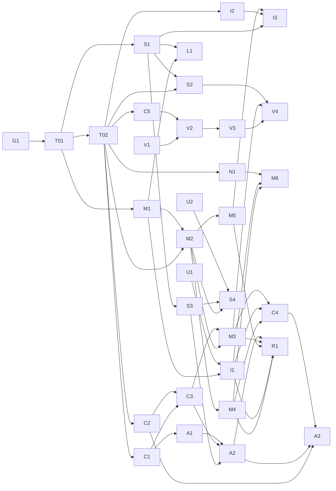

# Tasks and dependency graph

G1 passed 2026-11-09 (D-1, D-2). Milestone v0.1 = every task except V1–V4 (D-8). Task PRs merge into integration branch `v0.1` (D-9). U1 and U2 are Azhar's own tasks and can start now. V1 is an investigation that also needs GPU-spend approval.

Next step after G1: write a task contract per task (`docs/tasks/<ID>.md`, template `docs/templates/WORK-TEMPLATES.md` section 4) using the requirements-to-ready-task skill, starting with waves 1–3, then mark them Ready.

Sizes: S ≈ 1 day, M ≈ 2–4 days, L ≈ 1–2 weeks (rough, one part-time builder).

| ID | Task | Lane | Needs | Size | ACs | Done when |
| --- | --- | --- | --- | --- | --- | --- |
| G1 | Approve PRD-001 and TP-001 | You | — | S | — | Approvals recorded in docs/decisions |
| U1 | Pair band with Gadgetbridge; enable Health Connect sync | You | — | S | AC-8 | Band data visible in Health Connect |
| U2 | Request Xiaomi export; scan injury reports and old logs; list injuries | You | — | S | AC-9 | Files ready to import |
| V1 | Motion test: HY-Motion on a GPU pod, 5 exercises | AI demos | — (GPU approval) | M | AC-11 | 5 motion files exported |
| T01 | Monorepo scaffold: pnpm, TypeScript, lint, Vitest, CI | Foundation | G1 | S | — | Tests pass in CI |
| T02 | Data model and shared types | Foundation | T01 | M | — | Schema compiles; migrations run on phone and server |
| M1 | Expo app shell, tabs, development build | Mobile | T01 | M | — | Runs on the Pixel |
| S1 | Server: Hono, SQLite, Docker Compose, single-user token | Server + AI | T01 | M | AC-14 | `docker compose up` health check passes |
| M2 | Local DB, intake, profile and injury screens | Mobile | T02, M1 | M | AC-1 | Intake saved offline |
| C1 | Exercise catalogue v1 (free-exercise-db + own entries, injury flags) | Core/Catalogue | T02 | L | AC-2, AC-3 | 5+ options per session type |
| C2 | Safety rules: injury filter, spike guard, pain monitor | Core | T02 | M | AC-2, AC-4 | Unit tests per rule |
| C5 | Form-rule schema and joint-angle maths | Core | T02 | S | AC-11 | Angles from a skeleton frame |
| N1 | Nutrition targets and weight trend | Core | T02 | S | AC-12 | Tests pass |
| I2 | FIT/GPX/TCX writer | Integrations | T02 | S | AC-6 | Files validate |
| S2 | Phone ↔ server sync | Server + AI | S1, T02 | M | — | Round-trip works |
| S3 | AI provider adapter | Server + AI | S1 | S | AC-10, AC-14 | Chat call through each provider |
| L1 | Learn tab feeds (Knees Over Toes etc.) | Server + AI | S1, M1 | S | AC-13 | New uploads appear |
| I1 | Health Connect reader | Integrations | M1, U1 | M | AC-7, AC-8 | Band data in app |
| M4 | Set logging: tap, voice, rest timer | Mobile | M2 | M | AC-5 | Gym session logged without typing |
| M5 | GPS run tracker | Mobile | M2 | M | AC-6 | Route, pace, HR saved |
| C3 | Plan engine | Core | C1, C2 | L | AC-2, AC-3, AC-4 | Example week generated within rules |
| A1 | Evidence registry and knowledge base | Server + AI | C1 | M | AC-10 | Every rule links to a source |
| S4 | Scan import with approval | Server + AI | S3, M2, U2 | M | AC-9 | Scan becomes approved entries |
| V2 | Auto-check motion against form rules | AI demos | V1, C5 | M | AC-11 | Bad takes rejected |
| M3 | Plan calendar, Today, session player | Mobile | C3, M2 | L | AC-3, AC-11 | Today's session can be completed |
| M6 | Progress and nutrition screens | Mobile | M4, I1, N1 | M | AC-12 | Trends visible |
| A2 | AI coach chat with read tools and citations | Server + AI | S3, A1, C3 | M | AC-2, AC-10 | Answers cite sources, respect injuries |
| I3 | Strava upload or file export | Integrations | I2, S1, M5 | S | AC-6 | Run on Strava or as a file |
| V3 | Mannequin render + review | AI demos | V2 | M | AC-11 | 20 approved clips |
| C4 | Weekly adaptation | Core | M3, M4, I1 | M | AC-3 | Next week adapts |
| V4 | Clips hosted and played in app | AI demos | V3, S2, M3 | S | AC-11 | Clip or "film it" flag per exercise |
| R1 | Dogfood 2 weeks on the Pixel | You | M3, M4, M5, I1, A2 | — | all | 2 weeks logged, feedback written |
| A3 | Coach proposes plan changes via safety rules | Server + AI | A2, C2, C4 | S | AC-2, AC-10 | Rule-breaking proposal refused with reason |

## Waves (same wave = can run in parallel)

| Wave | Tasks |
| --- | --- |
| 0 (before gate) | G1, U1, U2, V1 |
| 1 | T01 |
| 2 | T02, M1, S1 |
| 3 | M2, C1, C2, C5, N1, I2, S2, S3, L1, I1 |
| 4 | M4, M5, C3, A1, S4, V2 |
| 5 | M3, M6, A2, I3, V3 |
| 6 | C4, V4, R1 |
| 7 | A3 |

Critical path: G1 → T01 → T02 → C1 → C3 → M3 → R1.

