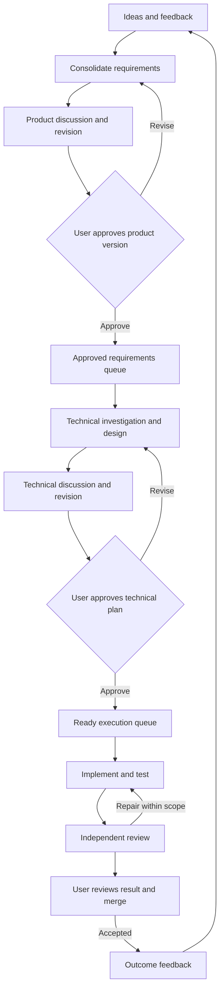

# Product and engineering pipelines

Date: 2026-09-19
Status: Proposed workflow with a local pilot deployed on 2026-09-19. See ../../work-control/README.md and ../../work-control/REPORT.md. Paperclip, PostgreSQL and AgentsView run locally; five roles are configured and paused. A Codex sandbox task passed. The full approval/dispatch workflow and real repository environments remain unverified. No cloud deployment exists.

## Operating model

The user owns product direction and consequential technical decisions across BigBull, VideoGen, and VideoTracker. Agents prepare decisions, preserve context, execute approved plans, and present evidence. Implementation, tests, and PR creation are allowed within approved scope; merging requires the user.

The system is self-hosted with no mandatory orchestration subscription. Paperclip is the recommended open-source foundation to pilot, not a claim that every workflow below exists without configuration or extensions.

## Two pipelines and their handoff

Both queues are durable. The first preserves requirements that are mature enough for technical planning; the second buffers executable tasks so workers do not need the user after each task. Research and discussion are work, but they do not grant permission to implement undecided scope.

## Requirements pipeline

| Stage | Agent responsibility | Output | User involvement |
|---|---|---|---|
| Intake | Capture requests and link context | Idea with project and origin | Describe desired outcome |
| Consolidation | Deduplicate, connect related requests, identify conflicts and missing information | Coherent feature brief with unresolved questions | Correct priorities or interpretation |
| Product discussion | Propose journeys, scope alternatives, acceptance criteria, and examples/prototypes when useful | PRD revision and a concise change summary | Decide scope and tradeoffs |
| Challenge/revision | Check contradictions, missing cases, testability, and fit with project goals | Revised PRD and decision log | Resolve remaining consequential questions |
| Product approval | Present the exact revision and unresolved items | Approved product version | Approve the outcome and exclusions |

Discussions can span multiple rounds. Every round shows what changed, which questions are resolved, what remains, and what recommendation the agent makes. Do not force a fixed number of rounds or keep agents debating after the requirements are clear. Superseded drafts remain available for reference.

## Engineering pipeline

| Stage | Agent responsibility | Output | User involvement |
|---|---|---|---|
| Investigation | Inspect the real repo and test feasibility | Evidence, constraints, unknowns | Only when a consequential tradeoff emerges |
| Technical proposal | Compare viable designs and present a recommendation | Technical plan with architecture decisions | Select consequential technical direction |
| Design review | Challenge compatibility, failure behavior, operations, and validation | Revised plan and recorded decisions | Approve the material changes |
| Breakdown | Produce dependency-ordered, reviewable tasks with acceptance checks | Ready work queue linked to approved versions | Review milestone scope; no routine task-by-task approval |
| Execution | Claim a task, implement, validate, checkpoint, and publish a PR | Review packet | Only product/technical exceptions outside the plan |
| Review and repair | Check the diff and evidence against requirements; repair within scope | Reviewable milestone/PRs | Decide merges and acceptance |
| Feedback | Compare the result to the desired outcome | Follow-up proposals | Decide priority of new scope |

Clarifying a major technical decision does not mean asking about variable names, routine libraries already chosen by the project, or normal coding details. Define examples of consequential decisions per project: data model/API compatibility, service boundaries, external providers, security model, material cost, and irreversible migrations.

## Handoff contract

Every implementation task references:

- Approved PRD ID and revision.
- Approved technical plan ID and revision, including the user decisions it depends on.
- Acceptance criteria IDs and expected review evidence.
- Repository/base commit, scope, relevant instructions, and environment requirements.
- Dependencies and whether merged code is required.
- Budget/retry limits and the actions the worker may take.

The dispatcher validates these fields before starting code work. A task title, project status, chat message, or unchecked backlog does not replace the handoff contract.

## Changes after approval

New requests enter the requirements pipeline. An agent performs an impact assessment against active tasks and proposes whether to finish, pause, or replace affected work. Approved versions remain immutable; approve a new revision to change direction. Unaffected tasks continue. Urgent stop requests pause affected dispatch immediately and request cancellation of active runs; the UI confirms when those processes have stopped.

## Continuous work

On a task/run/decision event or a scheduled reconciliation, a durable coordinator:

1. Reconciles active work and stale claims.
2. Selects approved tasks with satisfied dependencies and available capacity/budget.
3. Claims a task once and starts an isolated worker.
4. Saves checkpoints, evidence, and results.
5. Routes bounded repairs to execution and meaningful scope/design decisions to the user.
6. Dispatches other eligible work while blocked tasks wait.

Use deterministic code and persistent state for queue ownership, retries, and approval checks. Use models for analysis, planning, implementation, and review. A permanently running manager model is not required.

Continue only while useful eligible work exists. If no work qualifies, show the reason: requirements needed, technical approval needed, merge dependency, environment failure, budget/quota limit, or queue complete. Do not manufacture new scope or spend tokens to appear busy.

Because merges remain user-controlled, some dependencies will stop at review. Batch reviewable milestone results; prioritize independent work while waiting. Do not silently merge to maintain activity or assume dependent tasks may build on unapproved branches.

## Logical roles

- Product analyst: consolidates input, writes PRDs, maintains decisions.
- Technical lead: investigates repositories, proposes architecture, prepares task dependencies.
- Implementer: makes approved changes and supplies evidence.
- Reviewer: independently checks acceptance, code changes, and validation.

These are roles, not mandatory always-on agents. Use Codex and Claude for different runs; start with limited concurrency and add OpenCode only after its value and authentication are verified. Human product/technical approval cannot be replaced with agreement between two agents.

## Dashboard and drill-down

Executive view: milestone progress, outcomes delivered, active workers, ready-work availability, decisions/merges needed, spend, and last verified activity across all projects.

Project view: product pipeline, engineering pipeline, active specification versions, dependency board, previews, PRs, and decision history.

Run view: agent/model, task scope, branch/commit, logs, commands, checks, artifacts, retries, and checkpoints. Provide authenticated remote shell/editor access if required for investigation; surface whether interactive takeover pauses the active worker so two actors do not unknowingly edit the same checkout.

Report what is observed. Unknown model cost or child-worker counts should be labeled unavailable. A stale heartbeat is not evidence of ongoing useful work.

## Cloud deployment proposal

Start with one appropriately sized Linux VM, persistent storage, and backups. Run the open-source dashboard/coordinator and Postgres there, with isolated execution environments for repository work. CPU/memory must be sized for the actual builds and tests rather than only the dashboard. Grow to separate worker hosts when justified.

Expose an authenticated HTTPS interface to phone and laptop. Keep repository credentials and model authentication on the remote system with the required scopes. Remote repository checkouts and development dependencies let agents run with the laptop off. Models can remain hosted by AI providers; no GPU is needed merely to run their coding CLIs.

Remote equivalents for browser checks, app previews, MCP tools, and artifact storage must be verified individually. The current desktop session and its tools do not transfer merely because the code is cloned. Uncommitted work and ignored assets need an explicit migration inventory. Video generation or other GPU workloads are separately scoped if required.

Recurring charges: cloud compute/storage/backups/network and AI usage/subscriptions. Open-source operations still require updates, backups, and recovery procedures; setup should automate these where practical.

## Platform validation before relying on it

Paperclip documents adapters, persistent tasks, review stages, and cloud deployment. Validate the installed release against the specific workflow:

- Product and technical approvals are distinct, versioned, and actually gate implementation.
- Only the user can approve the consequential handoff stages assigned to them.
- UI statuses and issue permissions cannot accidentally bypass dispatch rules.
- Repository merge restrictions hold independently of tracker review state.
- Isolated workspaces and restart recovery work with the selected version.
- Mobile review, project views, artifacts, and drill-down are usable for real tasks.

Use existing capabilities first. Add a narrowly scoped workflow adapter/extension for missing gates or views. Do not rebuild the whole orchestration platform or promise that role prompts alone enforce the process.

## First end-to-end demonstration

One feature in one repo goes through at least one real product revision and technical discussion, gets explicit approved versions, then runs through implementation and independent review in the cloud. The user closes the laptop and later sees a working preview, checks, and a PR from the phone. A blocked decision pauses only its dependent tasks. Nothing merges without user approval.

Then onboard the other two projects and test that the dispatcher can continue independent work across the portfolio. Success is less user coordination per accepted milestone, with acceptable quality and cost.
